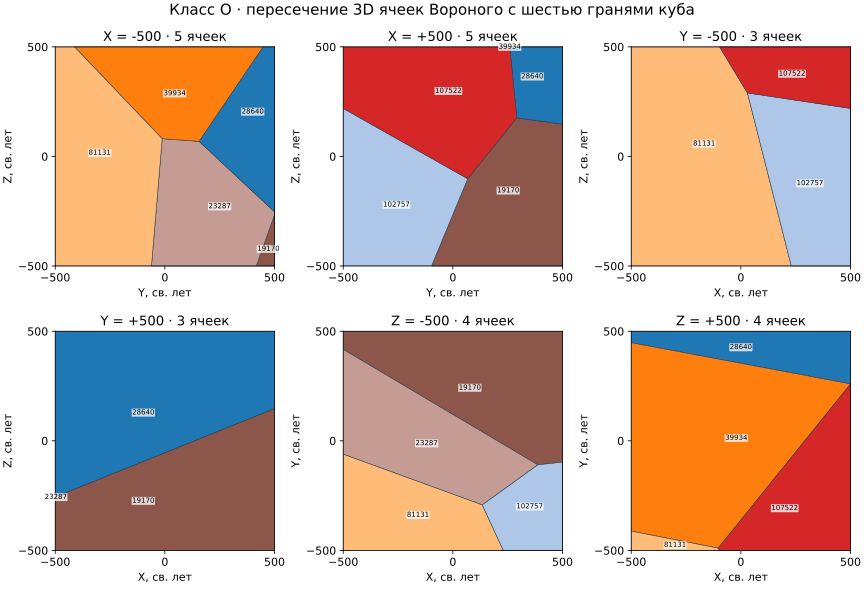
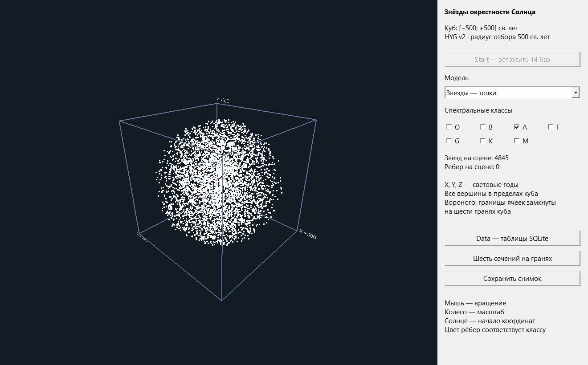
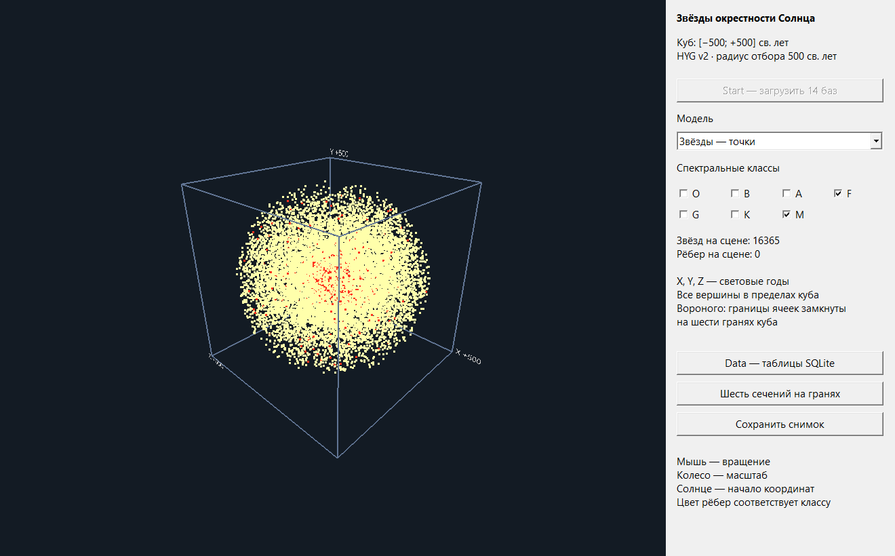
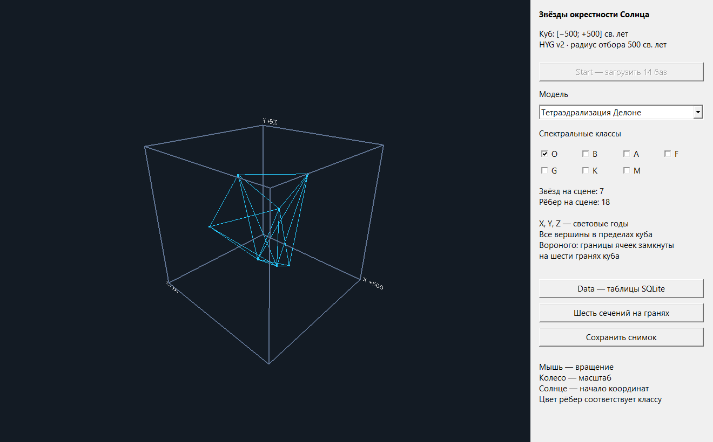
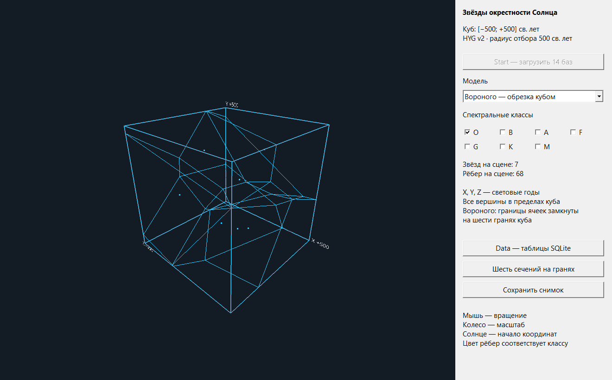
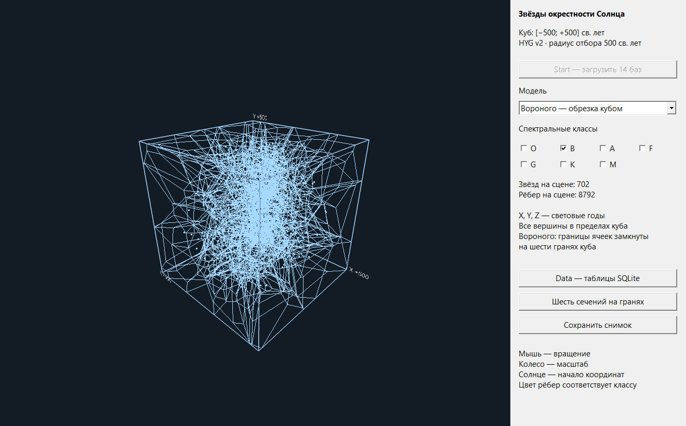
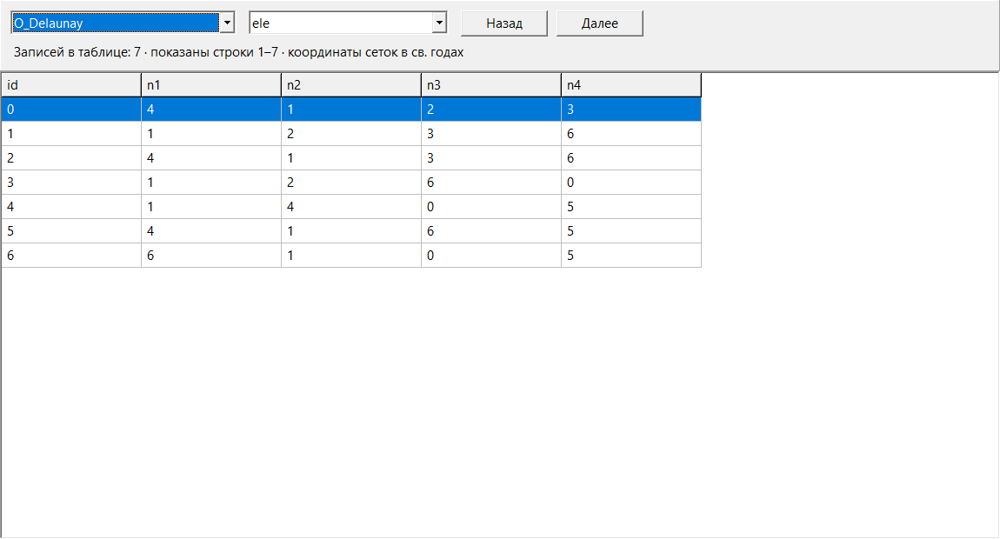

# Лабораторная работа №4

## Построение сеточной модели звёзд окрестности Солнца

C++Builder / VCL / GLScene · TetGen · SQLite · Python

## Задание

Ограничить сеточные модели рамками модели, куба с ребром 1000 св.лет.

Уточнение: Диаграмма Вороного должна быть обрезана по граням даммикуба рамок модели. Для визуализации 6-ти сечений мозаики полиэдральной сетки.

## Подготовка звёздного каталога

Использован каталог HYG v2 (`hygxyz.csv`, David Nash / Astronexus), содержащий 119 617 записей. Отбор по расстоянию выполнен с коэффициентом перевода из парсеков в световые годы $k=3{,}262$:

```sql
SELECT StarID, Distance*3.262 AS Light_Years,
       Spectrum, X, Y, Z
FROM hyg
WHERE Distance*3.262 <= 500;
```

Получено 42 748 записей. Результат сохранён в `500ly.sqlite`. Для семи классов выполняется запрос вида:

```sql
SELECT StarID, X, Y, Z FROM hyg
WHERE Spectrum LIKE 'O%';
```

Оператор `LIKE` в SQLite учитывает начальные латинские буквы без различия регистра. Получены 40 592 записи классов O, B, A, F, G, K, M; 2 156 записей с другими или отсутствующими начальными обозначениями не включены в эти семь сеток. Спектральные обозначения трактуются по указанному правилу фильтрации; физическая переклассификация звёзд не выполняется.

Координаты каталога, как и расстояния, заданы в парсеках. Для геометрических расчётов преобразованы все три координаты:

$$
(x,y,z)_{\text{св. лет}}=3{,}262 (X,Y,Z)_{\text{пк}}.
$$

Начало координат совпадает с Солнцем. Ось $X$ направлена к точке весеннего равноденствия, ось $Z$ — к северному полюсу мира, ось $Y$ — в направлении прямого восхождения $6$ ч. Область модели:

$$
C=\{(x,y,z): -500\leq x,y,z\leq500\}\quad\text{(св. лет)}.
$$

Отбор звёзд производится по шару радиуса 500 св. лет, а ограничение ячеек — по кубу. Поэтому углы куба содержат продолжения ячеек ближайших звёзд, хотя самих отобранных звёзд там нет.

Совпадающие координаты объединены перед тетраэдрализацией. Все исходные записи сохранены, а таблица `catalogue` связывает `StarID` с индексом геометрического узла `NodeID`. Объединено 14 повторных положений: одно в F, одно в G, два в K и десять в M.

Состав входных данных и тетраэдрализации

| Класс | Записей | Узлов | Тетраэдров | Рёбер Делоне |
| --- | --- | --- | --- | --- |
| O | 7 | 7 | 7 | 18 |
| B | 702 | 702 | 4207 | 5004 |
| A | 4845 | 4845 | 31574 | 36674 |
| F | 14292 | 14291 | 95000 | 109638 |
| G | 11942 | 11941 | 79351 | 91536 |
| K | 6720 | 6718 | 44275 | 51234 |
| M | 2084 | 2074 | 13554 | 15682 |

## Расчёт и ограничение сеток

### Вызов TetGen

Для каждого класса создан ASCII-файл `.node`. Его первая строка содержит число узлов, размерность 3, число атрибутов 0 и число маркеров 0. Индексы геометрических узлов непрерывны и начинаются с нуля; идентификаторы каталога хранятся отдельно.

Расчёт выполнен библиотекой `_tetgenDLL.dll` из приложенного архива. Консольная оболочка `tetgen_cli.exe` считывает узлы, вызывает `tetrahedralize` с ключами `zvfenQ` и сохраняет массивы результата. Ключ `z` задаёт нумерацию с нуля, `v` — диаграмму Вороного, `f` — все треугольные грани, `e` — рёбра, `n` — соседство тетраэдров, `Q` — краткий вывод.

В девяти файлах каждого класса сохранены вершины, рёбра, грани, тетраэдры и соседство Делоне, а также вершины, рёбра, грани и ячейки Вороного. Для класса O получены 7 тетраэдров, 18 рёбер Делоне, 7 вершин и 19 рёбер Вороного, включая 10 неограниченных лучей. Эти результаты соответствуют геометрии семи исходных звёзд класса O.

Все вершины Делоне лежат внутри куба, а куб выпуклый. Следовательно, каждый тетраэдр и каждое его ребро также целиком лежат в кубе. Добавлять фиктивные звёзды в углах куба не требуется: это изменило бы исходную диаграмму Вороного.

### Отсечение отрезков и лучей

Ребро Вороного записывается параметрически:

$$
q(t)=a+td,
 \qquad t\in[0,1]\ \text{для отрезка},\qquad
 t\in[0,+\infty)\ \text{для луча}.
$$

Для каждой координаты пересекается допустимый интервал параметра с условием $-500\leq a_j+td_j\leq500$. При $d_j\neq0$ его границы равны:

$$
t_j^- =\min\left(\frac{-500-a_j}{d_j},\frac{500-a_j}{d_j}\right),\quad
 t_j^+ =\max\left(\frac{-500-a_j}{d_j},\frac{500-a_j}{d_j}\right).
$$

При $d_j=0$ ребро отбрасывается только тогда, когда $a_j$ находится вне соответствующего слоя куба. Пустое пересечение интервалов означает отсутствие видимой части. Такой алгоритм сохраняет и отрезок, пересекающий куб при обеих внешних конечных точках. Для O куб пересекают 6 из 10 лучей.

При экспорте результатов приложенной DLL нормали граничных лучей развёрнуты в наружное направление. Ориентация проверена по условию трёх равноудалённых ближайших звёзд на каждом луче.

Одного отсечения исходных рёбер недостаточно для получения мозаики на гранях: необходимо построить новые границы ячеек в плоскостях куба.

### Замыкание ячеек на гранях куба

Для звезды $p_i$ ограниченная ячейка определяется пересечением полупространств:

$$
V_i^C=C\cap\bigcap_{j\neq i}
 \left\{x:\;2(p_j-p_i)\cdot x\leq
       \|p_j\|^2-\|p_i\|^2\right\}.
$$

В расчёте используются соседи $p_i$ по рёбрам Делоне: остальные ограничения избыточны. В локальных координатах $y=x-p_i$ неравенство принимает устойчивую к смещению форму

$$
\frac{p_j-p_i}{\|p_j-p_i\|}\cdot y
 \leq\frac{\|p_j-p_i\|}{2}.
$$

К этим условиям добавлены шесть плоскостей куба. Вершины пересечения вычислены методом `HalfspaceIntersection`; точка $y=0$ служит внутренней опорной точкой. Из вершин на каждой плоскости $x_j=\pm500$ построен выпуклый многоугольник. Его рёбра добавлены к отсечённым исходным рёбрам Вороного. Общие рёбра граничных многоугольников объединены с округлением координат до $10^{-6}$ св. года только для ключа сопоставления; сохраняемые координаты остаются вещественными.

На каждой грани получена мозаика пересечений трёхмерных ячеек, а не двумерная диаграмма проекций звёзд. Во втором случае потерялась бы составляющая расстояния, перпендикулярная грани, и результат был бы другим.



Шесть точных сечений для класса O. Внутри многоугольников указаны StarID. Каждый квадрат имеет сторону 1000 св. лет.

Граничные многоугольники ячеек Вороного

| Класс | X− | X+ | Y− | Y+ | Z− | Z+ | Всего |
| --- | --- | --- | --- | --- | --- | --- | --- |
| O | 5 | 5 | 3 | 3 | 4 | 4 | 24 |
| B | 35 | 27 | 50 | 51 | 52 | 40 | 255 |
| A | 104 | 104 | 135 | 161 | 124 | 129 | 757 |
| F | 166 | 152 | 147 | 154 | 193 | 152 | 964 |
| G | 125 | 123 | 116 | 101 | 122 | 119 | 706 |
| K | 113 | 116 | 108 | 106 | 109 | 106 | 658 |
| M | 22 | 26 | 25 | 21 | 23 | 23 | 140 |

## Приложение визуализации

Разработано приложение C++Builder / VCL / GLScene. Кнопка Start проверяет наличие 14 баз SQLite и загружает геометрию каждого класса в оперативную память. После загрузки доступны три режима: звёзды-точки, рёбра тетраэдрализации Делоне и ограниченная кубом диаграмма Вороного. Переключатели классов позволяют одновременно выводить несколько сеток; каждая построена отдельно по своему спектральному классу.

Компонент `TGLPoints` отображает звёзды, `TGLLines` — независимые отрезки рёбер, `TGLSceneViewer` — сцену. Мышью изменяется ракурс, колесом — масштаб. В правой панели показаны фактические числа отображаемых звёзд и рёбер. Каркас куба задаёт границы модели в световых годах.

Кнопка «Шесть сечений на гранях» открывает форму с шестью мозаиками и выбором класса. Мозаики заранее рассчитаны по тем же граничным многоугольникам, которые сохранены в SQLite. Цвет в этой форме различает ячейки; в основной трёхмерной сцене цвет обозначает спектральный класс.

Форма Data предоставляет выбор любой из 14 баз и таблицы внутри неё. Отображение постраничное, по 500 записей, с указанием полного числа строк. Базы открываются только для чтения. В базах Делоне находятся таблицы `node`, `edge`, `face`, `ele`, `neigh`, `catalogue`; в базах Вороного — `node`, `edge`, `face`, `cell`, а также `clipped_edges`, `caps`, `cell_volume`. Для граней и ячеек переменной длины список индексов сохранён в текстовом поле `members`. Таблица `caps` содержит номер грани куба, узел, StarID, площадь и упорядоченные вершины многоугольника.



Запуск приложения: точечная модель класса A, 4845 звёзд.



Совместный вывод точечных моделей F и M: 16 365 узлов двух моделей.



Тетраэдрализация класса O: 7 звёзд и 18 рёбер Делоне.



Ограниченная модель Вороного класса O: 68 рёбер, включая новые рёбра замыкания ячеек на кубе.



Модель Вороного класса B: 702 звезды и 8792 рёбра после ограничения и замыкания.



Форма Data: просмотр таблицы тетраэдров класса O в SQLite.

## Проверка результата

Для всех 267 968 тетраэдров независимо вычислены центры описанных сфер. Поиск ближайшего узла по KD-дереву подтвердил отсутствие звёзд внутри этих сфер с относительным допуском $10^{-7}$. Сумма объёмов тетраэдров каждого класса согласована с объёмом выпуклой оболочки его узлов с относительным допуском $10^{-9}$.

Проверены координаты всех отображаемых рёбер Вороного: они принадлежат $[-500;500]$ с численным допуском $10^{-8}$ св. года. Для вершин и центроидов всех граничных многоугольников проверено, что соответствующая звезда является ближайшей среди всех узлов класса, с абсолютным допуском $10^{-6}$ св. года. Для класса O ячейки дополнительно пересчитаны с ограничениями от всех остальных звёзд, без использования соседства Делоне.

Контроль объёма и покрытия границ для каждого класса

| Класс | Ячеек | Сумма объёмов, св. лет³ | Максимальная ошибка площади грани, св. лет² |
| --- | --- | --- | --- |
| O | 7 | 1 000 000 000 | $1.16\cdot10^{-10}$ |
| B | 702 | 1 000 000 000 | $2.33\cdot10^{-10}$ |
| A | 4845 | 1 000 000 000 | $3.49\cdot10^{-10}$ |
| F | 14291 | 1 000 000 000 | $3.49\cdot10^{-10}$ |
| G | 11941 | 1 000 000 000 | $2.33\cdot10^{-10}$ |
| K | 6718 | 1 000 000 000 | $3.49\cdot10^{-10}$ |
| M | 2074 | 1 000 000 000 | $1.16\cdot10^{-10}$ |

Для каждого класса сумма объёмов ячеек равна $10^9$ св. лет$^3$ с максимальной абсолютной погрешностью $1{,}20\cdot10^{-7}$. Сумма площадей многоугольников на каждой грани равна $10^6$ св. лет$^2$ с погрешностью не более $3{,}50\cdot10^{-10}$. Совместно с проверкой ближайшей звезды это подтверждает покрытие куба. Для всех 2494 исходных лучей и сохранившихся частей рёбер Вороного проверены три равноудалённые ближайшие звезды с относительным допуском $10^{-8}$. Проверка `PRAGMA integrity_check` для всех 14 баз дала результат `ok`.

## Запуск и воспроизведение

Готовая версия для Windows 10/11 с библиотеками и всеми базами данных находится в
[релизе v1.0.0](https://github.com/danil-890/lab4-stellar-mesh/releases/tag/v1.0.0), архив `lab4-complete.zip`.
После распаковки запустите `run.cmd`, нажмите Start, выберите классы и режим.
Мышь вращает сцену, колесо меняет масштаб. Data открывает таблицы SQLite,
кнопка «Шесть сечений на гранях» — граничные мозаики.

Для сборки из исходников нужны C++Builder 13, Windows SDK и Python с пакетами из
`requirements.txt`. Исходники и совместимые библиотеки GLScene включены в `vendor/GLScene`.
Библиотека TetGen из задания и консольная оболочка включены в проект.
Большие производные базы и промежуточные файлы создаются следующими командами из корня:

```console
python -m pip install -r requirements.txt
python source/prepare.py
python source/plots.py
python source/verify.py
build.cmd
```

После сборки скопируйте `bin/Win32/Release/StarMesh.exe` в `bin`.
Для запуска также нужны совместимые RTL/VCL/GLScene-библиотеки: они включены в готовый
архив релиза. Подробности сборки, форматов данных, ABI TetGen и воспроизведения снимков
приведены в [инструкции](docs/BUILD.md).

Основной код приложения — [MainForm.cpp](source/MainForm.cpp), расчёт сеток —
[prepare.py](source/prepare.py), независимые проверки — [verify.py](source/verify.py).
Расчётные итоги сохранены в [summary.json](results/summary.json), результаты проверок —
в [verification.json](results/verification.json).

Печатная версия отчёта — [main.pdf](main.pdf), исходник — [main.tex](main.tex).
Актуальные файлы отчёта также доступны в [релизе v1.0.1](https://github.com/danil-890/lab4-stellar-mesh/releases/tag/v1.0.1).
Для сборки отчёта нужен XeLaTeX или LuaLaTeX, Times New Roman и JetBrains Mono;
выполните `xelatex main.tex` два раза. Титульный лист оформляется отдельно.
Снимки в `images/` получены из работающего приложения, редактируемые сечения SVG
сохранены в `results/CLASS/sections.svg`.

Каталог HYG v2: David Nash / Astronexus, CC BY-SA 2.5. Условия и происхождение данных
сохранены в [HYG-LICENSE.txt](data/HYG-LICENSE.txt) и [provenance.json](data/provenance.json).
Производные каталоги и сетки сохраняют атрибуцию и лицензию CC BY-SA 2.5.
GLScene распространяется по MPL 2.0; его лицензия сохранена в `vendor/GLScene/LICENSE`.
Условия TetGen находятся в исходном архиве задания и заголовке `vendor/tetgen/tetgen.h`.

## Вывод

В ходе лабораторной работы было выполнено построение сеточных моделей звёзд окрестности Солнца по каталогу HYG: рассчитаны тетраэдрализации Делоне и диаграммы Вороного семи спектральных классов с помощью TetGen, сформированы базы SQLite и реализована визуализация средствами GLScene. Модели ограничены кубом с ребром 1000 световых лет. Ячейки Вороного замкнуты по его граням, получены все шесть сечений мозаики для каждого класса. Корректность ограничения подтверждена проверками ближайших звёзд, объёмов ячеек и площадей граничных многоугольников.

Репозиторий программной реализации: [github.com/danil-890/lab4-stellar-mesh](https://github.com/danil-890/lab4-stellar-mesh).
