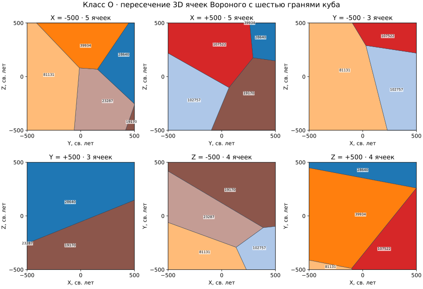
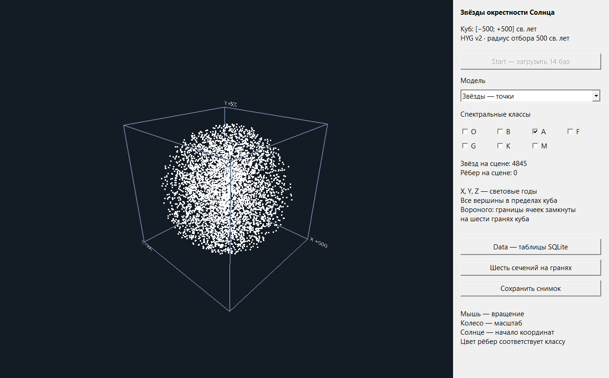
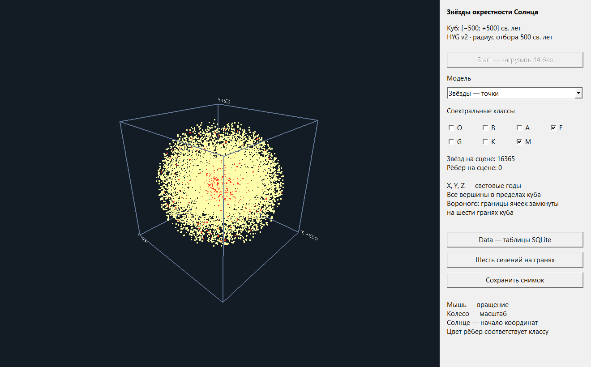
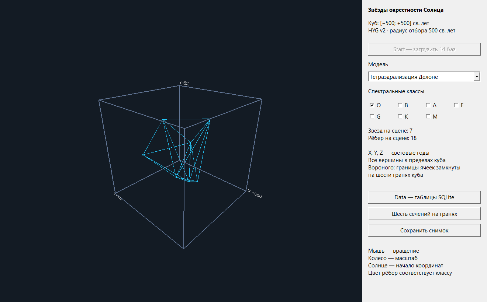
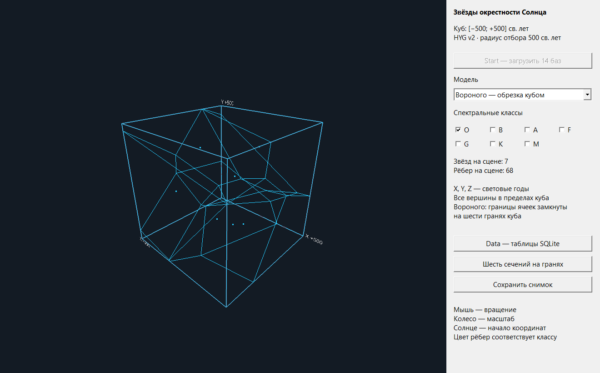
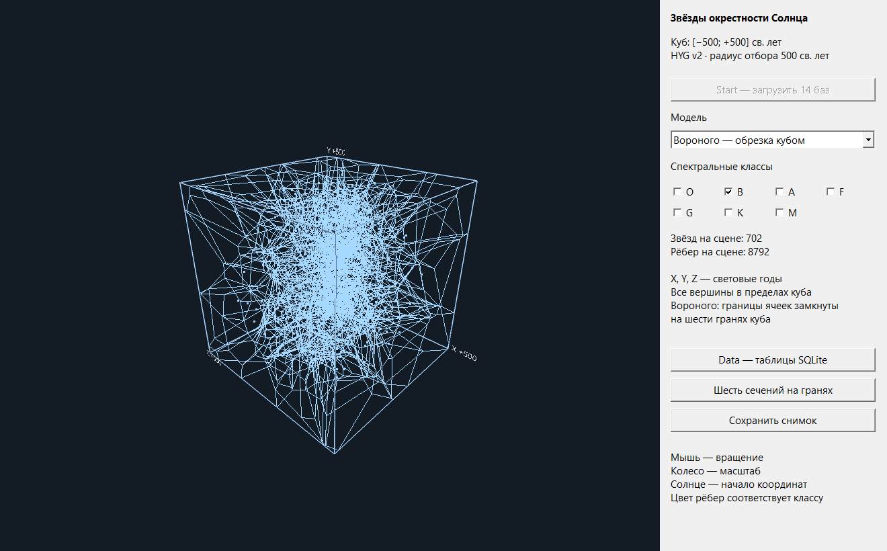
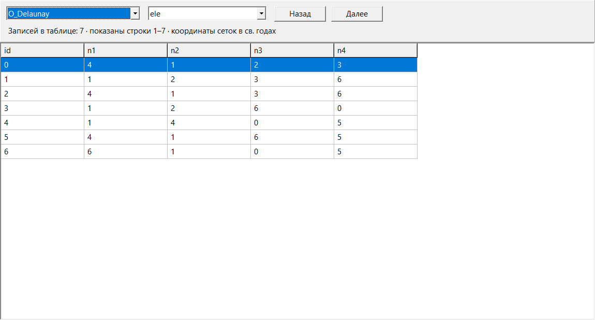

# Лабораторная работа №4

Построение сеточной модели звёзд окрестности Солнца.

## Задание

Ограничить сеточные модели рамками модели, куба с ребром 1000 св.лет.

Уточнение: Диаграмма Вороного должна быть обрезана по граням даммикуба рамок модели. Для визуализации 6-ти сечений мозаики полиэдральной сетки.

## Ход работы

Из каталога HYG v2 отобраны 42 748 звёзд в пределах 500 световых лет.
Координаты переведены из парсеков умножением на 3,262.
Для классов O, B, A, F, G, K, M получены 40 592 записи и 40 578 узлов отдельных сеток после объединения совпадающих положений.

Для каждого класса с помощью TetGen построены сетка Делоне и диаграмма Вороного.
Рёбра Вороного обрезаны кубом от −500 до +500 световых лет по каждой оси.
На гранях построены замыкающие многоугольники ячеек и шесть мозаик.
Результаты сохранены в 14 базах SQLite.

Приложение показывает звёзды, сетку Делоне и диаграмму Вороного.
Классы можно включать одновременно; Data открывает таблицы, отдельная форма — шесть сечений.

## Результаты

Шесть сечений ячеек класса O по граням куба; числа — StarID.

Проверены 267 968 тетраэдров, границы модели и целостность баз.
Для каждого класса сумма объёмов ячеек равна 10⁹ св. лет³, а площадь мозаики на каждой грани — 10⁶ св. лет² с учётом численной погрешности.

HYG v2: David Nash / Astronexus, CC BY-SA 2.5; условия — в `data/HYG-LICENSE.txt`.
Лицензия GLScene сохранена в `vendor/GLScene/LICENSE`.

## Вывод

В ходе лабораторной работы было выполнено построение сеток Делоне и диаграмм Вороного семи классов звёзд. Модели ограничены кубом с ребром 1000 световых лет, получены шесть граничных мозаик для каждого класса и реализован их просмотр.
